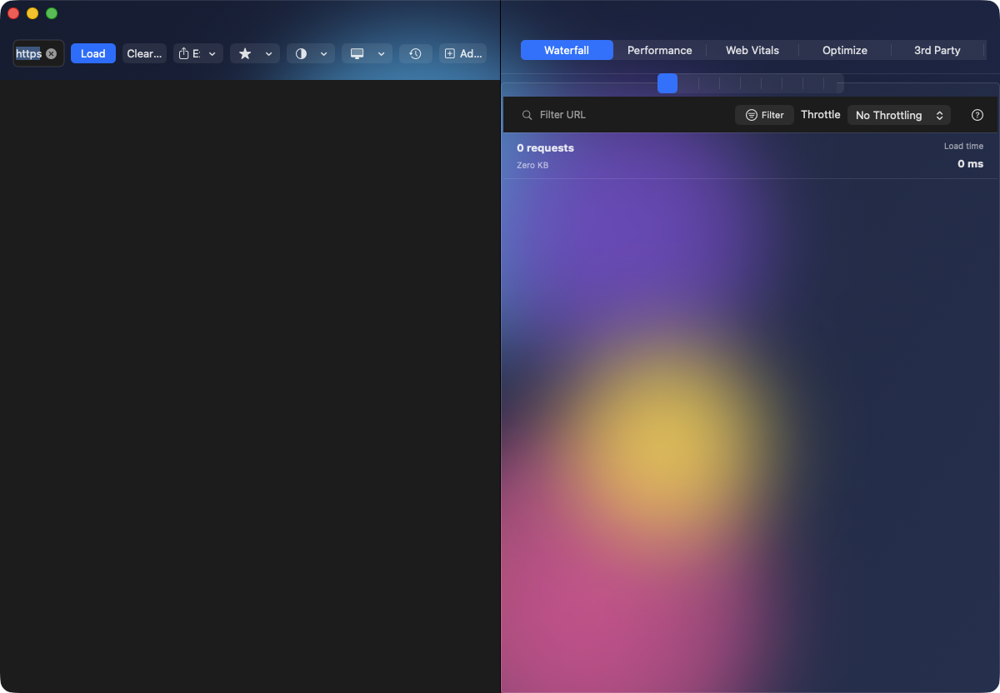
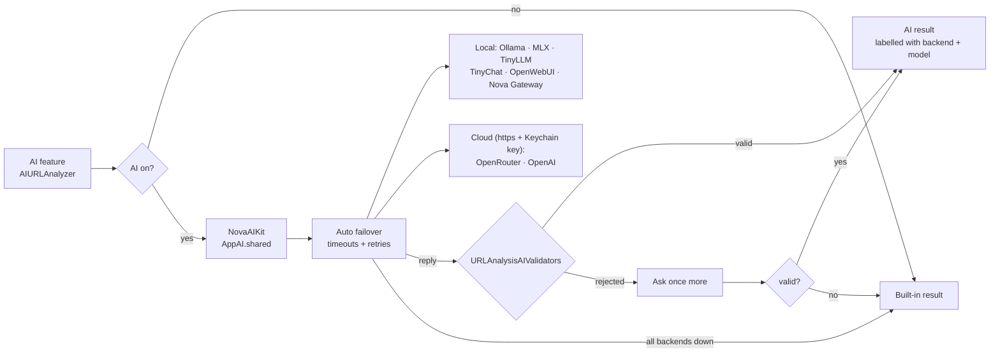
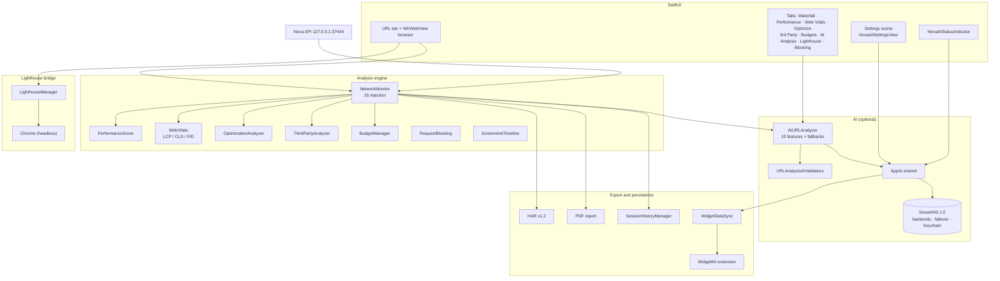

# URL Analysis

A native macOS web performance analysis tool: network waterfall, Core Web Vitals, performance scoring, optimization
and third-party analysis, Lighthouse, request blocking, and ten optional AI features. The AI features run on
[NovaAIKit](https://github.com/kochj23/NovaAIKit), so they work with local or cloud models and fall back to built-in
analysis when AI is off or unreachable.




---

## Features

| Feature | Description |
|---------|-------------|
| Network waterfall | Real-time HAR-compatible request waterfall with DNS, connect, SSL, TTFB and download timing breakdowns |
| Performance scoring | Weighted composite score (0-100): load time 30%, resource count 20%, total size 20%, Web Vitals 30% |
| Core Web Vitals | LCP, CLS and FID measured through WKWebView JavaScript injection, scored against Google thresholds |
| Optimization suggestions | Detects uncompressed assets, render-blocking resources and oversized images, with impact and difficulty ratings |
| Third-party analysis | Identifies external domains, categorizes 23 known providers (analytics, ads, CDN, social) and measures their load cost |
| Performance budgets | Thresholds for page size, request count, load time and resource sizes, with Desktop / Mobile / PWA presets |
| Google Lighthouse | Runs the Lighthouse CLI in headless Chrome: Performance, Accessibility, Best Practices, SEO and PWA scores |
| AI analysis (optional) | Ten AI features, each with a built-in fallback (see [AI](#ai)) |
| Device emulation | Desktop, iPhone 15 Pro / Pro Max, iPhone SE, iPad and iPad Pro profiles (viewport, pixel ratio, user agent) |
| Screenshot timeline | Rendering filmstrip at 0s, 0.5s, 1s, 2s, 3s and 5s |
| Request blocking | Blocks domains or resource types (ads, trackers, images, scripts) with WKContentRuleList |
| Session history | Saves every analysis with full metrics, Web Vitals, device profile and timestamp |
| Export | HAR v1.2 JSON and multi-page PDF reports with an executive summary and filmstrip |
| URL comparison | Several browser sessions in tabs for side-by-side comparison |
| Desktop widget | WidgetKit extension (small / medium / large) with score, Web Vitals, history and AI status |
| Nova API server | Local HTTP API on port 37444, bound to 127.0.0.1 only (`GET /api/status`, `GET /api/ping`) |

---

## AI

AI is optional. Configure it in **URL Analysis > Settings… > AI** (or the "AI Settings" button on the AI Analysis tab).

- **On/off switch.** With AI off, nothing leaves the Mac and every feature shows its built-in result.
- **Backends:** Auto (failover in order), Ollama, MLX, TinyLLM (by Jason Cox), TinyChat, OpenWebUI, Nova Gateway,
  OpenRouter and OpenAI, with a model picker and editable URLs for each.
- **Keys** live only in the macOS Keychain under `com.jkoch.urlanalysis.<backend>` (account `apiKey`). They are shown
  as "stored", never as text, and are only ever sent over https.
- **Status indicator** in the AI Analysis header: green = a backend is online, orange = none reachable, grey = AI off.
  Click it to re-check.
- **Failover and timeouts:** Auto tries each reachable backend in turn, with per-request timeouts and retries.
- **Output validation:** every reply is checked (and clamped) before it is shown. A rejected reply is retried once,
  then the built-in result is used. Each result is labelled with where it came from, e.g. "AI · Ollama (qwen3:8b)" or
  "Built-in".

| AI feature | Built-in fallback | Validation |
|------------|-------------------|------------|
| Performance insights | Score-based summary | Non-empty plain text; figures must match the measured data |
| Security analysis | Rule-based checks (HTTP, suspicious TLDs, mixed content) | Risk level must be known; AI can raise the risk but never lower it below the rule-based level |
| Optimization coach | Priority, impact and description per suggestion | Non-empty, length-capped |
| Technology stack | URL and header pattern detection | JSON with at least one detected technology |
| Privacy impact | Tracker detection with a score of 100 - 10 per tracker | Score clamped to 0-100; tracker list is always the locally detected one |
| Ask AI (Q&A) | Explains why AI didn't answer and shows the measured page data | Non-empty plain text, capped |
| Code fixes | Template fixes (for example image lazy loading) | Code required; language limited to known values |
| Time machine (what-if) | Size and time savings from the affected resources | Score clamped to 0-100; confidence High / Medium / Low |
| Trend analysis | Statistical trend summary (needs 5+ sessions) | Summary required; labels clamped; anomalies need ISO-8601 dates |
| Regression detection | Score delta against the median baseline | Severity clamped; "no regression" forces severity none |

**Upgrading from 1.3.x:** your backend, URLs, Ollama model and on/off setting are imported once. An OpenAI key stored
by the old version (in the `com.jordankoch.URLAnalysis` Keychain item, or in plaintext in UserDefaults) is moved to
`com.jkoch.urlanalysis.openai`. Keys for the removed Google Cloud, Azure, AWS and IBM Watson backends, and the old
prompt usage log, are deleted. Those four backends are no longer supported.



---

## Architecture



---

## Requirements

| Requirement | Minimum |
|-------------|---------|
| macOS | 14.0 (Sonoma) |
| Xcode (to build) | 16 or later |
| Lighthouse (optional) | Node.js, the `lighthouse` npm package and Chrome |
| AI (optional) | Any NovaAIKit backend, e.g. a local Ollama |

## Installation

1. Download the latest DMG from [Releases](https://github.com/kochj23/URL-Analysis/releases) (`URL-Analysis-v1.4.0-build5.dmg`).
2. Open it and drag **URL Analysis** onto **Applications**.
3. Distributed outside the App Store (ad hoc signed for local use).

Optional extras:

```bash
npm install -g lighthouse          # Lighthouse tab (Chrome or Chromium must also be installed)
brew install ollama && ollama serve && ollama pull qwen3:8b   # local AI
```

## Building

```bash
git clone git@github.com:kochj23/URL-Analysis.git
cd URL-Analysis
xcodebuild -project URL-Analysis.xcodeproj -scheme "URL Analysis" -configuration Release -derivedDataPath ./dd build
```

Swift Package Manager resolves NovaAIKit (`https://github.com/kochj23/NovaAIKit.git`, from 1.0.0) on the first build.
The Release build has zero compiler warnings.

## Testing

```bash
xcodebuild test -project URL-Analysis.xcodeproj -scheme "URL Analysis" -destination 'platform=macOS' -derivedDataPath ./dd
```

297 tests in 12 files. The AI tests never touch the network or the real Keychain (stub `URLProtocol`, in-memory
settings and key store).

| Test file | Tests | Covers |
|-----------|------:|--------|
| AIKitAdoptionTests | 29 | NovaAIKit contract in all 7 categories: unit (validators, service names), security (Keychain-only keys, legacy key migration, https-only keys, no legacy AI code), functional (all 10 features with AI off and offline), integration (stubbed backend, settings migration), retry (reject → retry → fallback), performance, frame/UI state |
| ComprehensiveTests | 86 | URL parsing, CLI formatting, AI data models, security (no hardcoded secrets, Keychain, loopback API), widget sync, integration, functional, frame |
| NetworkMonitorTests | 28 | ResourceTimings, filters, throttling, MIME detection, HAR encoding |
| WebVitalsTests | 24 | LCP / CLS / FID thresholds, boundaries, Codable, clamping |
| PerformanceScoreTests | 24 | Score components and weighting |
| EthicalGuardianTests | 23 | Standalone content-pattern regex checks |
| DeviceEmulationTests | 20 | Device presets, lookup, Codable |
| ThirdPartyAnalysisTests | 18 | Provider identification and impact classification |
| PersistentSessionTests | 15 | Domain extraction, ratings, Codable, session index |
| SecurityTests | 14 | URL scheme validation, SSRF private-IP detection, SHA256, API loopback |
| PerformanceBudgetTests | 8 | Presets, defaults, violation severity |
| RequestBlockingTests | 8 | Blocking profiles and content-rule JSON |

## Changelog

See [CHANGELOG.md](CHANGELOG.md).

## License

MIT License. Copyright (c) 2025-2026 Jordan Koch. See [LICENSE](LICENSE).

---

Written by Jordan Koch
